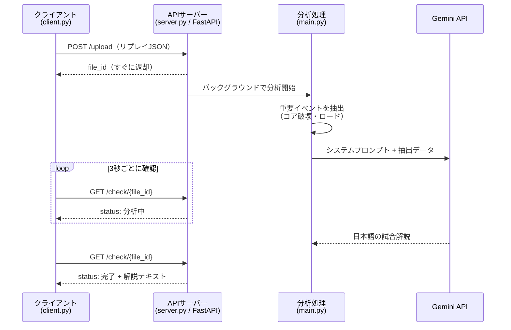

# SSA Match Analysis

**3対3のRTSゲームの試合リプレイ（JSON）を読み込み、生成AI（Google Gemini）が日本語の試合解説レポートを自動で作成する API サーバーです。**

1試合あたり数MB〜十数MBある試合ログから、勝敗を左右したイベントだけを抽出し、eスポーツの解説記事のような読みやすい文章に変換します。

- **言語**：Python 3.14
- **主な技術**：FastAPI / Google Gemini API（google-genai）/ Pydantic / Jupyter Notebook
- **開発形態**：個人開発（データ調査・設計・実装・プロンプト設計まで一人で担当）→ [開発について](#開発について)
- **ポイント**：12.2MBの試合ログを約475トークンに要約して LLM に渡す前処理、待ち時間の長い AI 処理を非同期で扱う API 設計、ゲーム固有の文脈を伝えるプロンプト設計

---

## デモ：入力と出力

以下はすべて、実際のリプレイ1件を処理した結果です。

### 入力：試合リプレイ（JSON・約12.2MB・211ティック）

ティック（ゲーム内の時間単位）ごとに、ユニットの位置・戦闘・資源などがすべて記録されています。

→ 構造がわかる抜粋：[examples/input_replay_excerpt.json](examples/input_replay_excerpt.json)

### ① 前処理：勝敗に関わる情報だけを抽出（12.2MB → 443文字）

```xml
<data>
<winner>TEAM_B</winner>
<time>211</time>
<names>{}</names>
<fractions>{'A1': 'infected', 'A2': 'robots', 'A3': 'infected', 'B1': 'robots', 'B2': 'robots', 'B3': 'infected'}</fractions>
<lord>ロードは132ティック目にプレイヤーB1によって撃破され、TEAM_Bの味方として召喚された</lord>
<crash> 108ティック目に、プレイヤーA2のコアが、攻撃側のプレイヤーB1によって破壊された </crash>,
<crash> 111ティック目に、プレイヤーA1のコアが、攻撃側のプレイヤーB1によって破壊された </crash>,
<crash> 210ティック目に、プレイヤーA3のコアが、攻撃側のプレイヤーB1によって破壊された </crash>,
</data>
```

→ [examples/gemini_input.txt](examples/gemini_input.txt)

### ② 出力：Gemini が生成した試合解説（抜粋・編集なし）

> 今回の対戦は、**TEAM Bが圧勝**を収める結果となりました。試合全体を通じて、TEAM Bの**B1選手（ロボット勢力）**が目覚ましいパフォーマンスを発揮し、チームを完全勝利へと導きました。
>
> （中略）
>
> 2つのコアを破壊して完全に主導権を握ったTEAM Bは、マップ中央の重要オブジェクト「ロード」の確保に動きます。132ティック目、ここでも**B1**がしっかりとトドメを刺し、**ロードをTEAM Bの味方として召喚**することに成功しました。強力なロードと共に進軍するTEAM Bに対し、孤立したA3に防衛の術はありませんでした。
>
> （中略）
>
> ゲーム内の主要なビッグプレイをすべて一人で達成するという、まさに「無名の新人が魅せた圧巻のキャリー（圧勝）」と言える素晴らしい試合でした。TEAM Aとしては、108〜111ティックのB1による怒涛の連続攻撃を防ぎきれなかったことが悔やまれる結果となりました。

→ 全文（チーム構成・試合展開・総評）：[examples/output_analysis.md](examples/output_analysis.md)

---

## 仕組み



1. **受付**：FastAPI がリプレイを受け取り、タスクIDをすぐに返します。
2. **抽出**：全ティックのイベントを走査し、コアが破壊された戦闘（`BATTLE_RESOLVED` かつ `core_destroyed`）と、ロードを獲得したプレイヤー・ティックを特定します。
3. **生成**：抽出したデータを XML タグで構造化し、システムプロンプトと一緒に Gemini へ送信します。
4. **取得**：クライアントは `/check/{file_id}` を定期的に確認し、完了したら解説を受け取ります。

---

## 工夫した点

### 1. LLM に渡すデータを「勝敗の要点」に絞り込み

リプレイは1件あたり2〜18MBあり、ユニット座標や拠点の状態が毎ティック記録されています。そのまま渡すとトークン量とコストが膨大になるため、まず Jupyter Notebook でデータ構造を調査し（[analysis/](analysis/)）、試合の流れを決めるイベント（コア破壊・ロード撃破）を特定しました。
その結果、12.2MBのリプレイを**システムプロンプト込みで約475トークン**まで圧縮しています。不要な情報を減らすことで、モデルが重要な出来事に集中できるようにしています。

### 2. 時間のかかる AI 処理を非同期で実行

Gemini の応答には数十秒〜数分かかることがあります。リクエストを待たせ続けるとタイムアウトの原因になるため、FastAPI の `BackgroundTasks` で分析をバックグラウンド実行し、クライアントはタスクIDで進捗を確認する方式にしました。

### 3. ゲーム固有の文脈を伝えるプロンプト設計

- 入力を `<winner>` `<lord>` `<crash>` などの XML タグで構造化し、各タグの意味をシステムプロンプトで定義
- 「ロード（マップ中央の中立ユニット。倒したチームの味方になる）」など、ゲーム固有のルールを説明
- プレイヤー名がない試合では「無名の新人プレイヤー」とみなすなど、データが欠けている場合の振る舞いも指定
- 入力には英語のキーや名前が混在するため、出力言語を日本語に明示的に固定

### 4. エラーへの備え

- Gemini API でエラーが起きた場合は `status: "error"` を返し、クライアント側で案内メッセージを表示
- プレイヤー名のデータを持たない形式のリプレイにも対応

---

## API

| メソッド | パス | 説明 | レスポンス例 |
|---|---|---|---|
| `POST` | `/upload` | リプレイを登録し、分析を開始します。ボディ：`{"replay": { ... }}` | `{"file_id": 1}` |
| `GET` | `/check/{file_id}` | 分析の状態と結果を返します。 | `{"status": "分析中", "text": ""}`<br/>`{"status": "完了", "text": "（解説）"}`<br/>`{"status": "error", "text": "error"}` |

存在しない `file_id` を指定すると `404`（`{"detail": "指定されたタスクは存在しません"}`）を返します。
サーバー起動中は http://127.0.0.1:8000/docs で API ドキュメント（Swagger UI）を確認できます。

---

## セットアップと実行

**必要なもの**：Python 3.14（開発・動作確認バージョン）、Gemini API キー（[Google AI Studio](https://aistudio.google.com/apikey) で取得）

```bash
git clone https://github.com/gerahertzjpn/SSA-matchanalysis.git
cd SSA-matchanalysis

python -m venv .venv
.venv\Scripts\activate        # Windows
# source .venv/bin/activate   # macOS / Linux

pip install -r requirements.txt
```

`.env.example` をコピーして `.env` を作成し、API キーを設定します。

```
GEMINI_API_KEY=your-api-key-here
```

サーバーを起動します。

```bash
uvicorn server:app --reload
```

別のターミナルでクライアントを実行します。

```bash
python client.py
```

```
ステータス: 分析中
ステータス: 分析中
...
ステータス: 完了
結果: バーチャルeスポーツRTSの試合アナリストとして、211ティックに及んだ白熱の3対3マッチを解説いたします。
...
```

> **補足**：リプレイデータはサイズが大きいため、リポジトリには含めていません。`replays/` フォルダにリプレイの JSON を置き、`client.py` の読み込みパスを合わせてください。

---

## 入力データの形式

| キー | 内容 |
|---|---|
| `meta.winner` | 勝者（`TEAM_A` / `TEAM_B` / `DRAW`） |
| `meta.total_ticks` | 試合時間（ティック数、最大300） |
| `meta.player_factions` | 各プレイヤーの勢力（`humans` / `robots` / `infected`） |
| `meta.player_names` | プレイヤー名（含まれない場合あり） |
| `ticks[].events` | そのティックに起きたイベント（`MOVE`、`BATTLE_STARTED`、`BATTLE_RESOLVED` など） |
| `ticks[].baron` | ロードの状態（`allied_lord_owner` で獲得したプレイヤーがわかる） |

プレイヤーは `A1`〜`A3`（チームA）と `B1`〜`B3`（チームB）のキーで識別されます。

---

## ディレクトリ構成

```
SSA-matchanalysis/
├── server.py            # FastAPI サーバー（/upload, /check）
├── main.py              # 分析処理：イベント抽出 → Gemini 呼び出し
├── client.py            # 動作確認用クライアント（アップロード → 結果のポーリング）
├── analysis/            # リプレイのデータ構造を調査した Jupyter Notebook
│   ├── dataanalys.ipynb     # meta（試合全体の情報）の調査
│   ├── matchanalys.ipynb    # ticks（ティックごとのイベント）の調査
│   └── loardanalys.ipynb    # ロードの状態の調査
├── examples/            # 入力・出力のサンプル
│   ├── input_replay_excerpt.json
│   ├── gemini_input.txt
│   └── output_analysis.md
├── requirements.txt
└── .env.example
```

---

## 今後の改善予定

- タスク管理をメモリ上の辞書から Redis やデータベースへ移行し、サーバー再起動後も結果を保持する
- Gemini API 呼び出しにタイムアウトとリトライを追加する
- 戦闘の開始〜終了の流れや資源の推移など、分析に使う指標を増やす
- 自動テストを追加する

---

## 開発について

個人で開発したプロジェクトです。以下の工程はすべて自分で行いました。

- リプレイデータの構造調査と、分析に使う情報の選定（Jupyter Notebook）
- 重要イベント（コア破壊・ロード獲得）を抽出するロジックの実装
- FastAPI による API サーバーと非同期処理の設計・実装
- Gemini 向けプロンプトの設計
- 動作確認用クライアントの作成、エラー処理の実装と不具合の修正

**生成AIの活用について**
当初ロシア語で書いていたコメント・プロンプト・メッセージの日本語化と、本 README の作成・サンプル（[examples/](examples/)）の整理には、AI アシスタント（Claude）を活用しました。日本語化したプロンプトについては、元のプロンプトと同等の品質の解説が出力されることを、実際のリプレイを使って比較・確認しています。